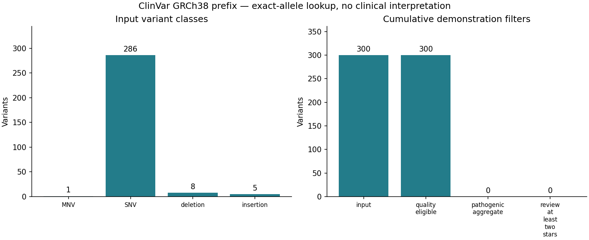

# Variant annotation pipeline

## Question

Can a public VCF be annotated and filtered reproducibly with a small local
resource, without downloading a VEP or SnpEff database?

## Approach

This Python pipeline performs an **exact-allele ClinVar lookup** on GRCh38.
The bundled demonstration contains the first 300 records of the archived
[2026-10-04 ClinVar VCF](https://ftp.ncbi.nlm.nih.gov/pub/clinvar/vcf_GRCh38/archive_2.0/2026/clinvar_20261004.vcf.gz),
in source order. The download script streams only the required compressed prefix.
The [manifest](data/manifest.json) records the URL, release, retrieval timestamp,
assembly and SHA-256 hashes of the extracted files.

The original records are retained in `data/clinvar_source.vcf` as the local
annotation resource. `data/sites.vcf` has the same alleles with ID and INFO removed.
The pipeline rejoins gene (`GENEINFO`), molecular consequence (`MC`), germline
classification (`CLNSIG`) and review status (`CLNREVSTAT`) on chromosome, position,
REF and ALT. These annotations come from ClinVar; they are not newly predicted.
The source already contains the demonstration alleles, so match coverage measures
a technical round trip, not independent annotation accuracy.

Variant class is calculated from allele lengths; SNVs also receive a transition
or transversion label. Indels are classified by net length change, without
reference-based normalization. Unsupported symbolic, ambiguous or multiallelic
records, duplicate keys, malformed records and VCFs without a GRCh38 declaration
are rejected before outputs are written. Chromosome names must match exactly.

The cumulative filtering rules are:

1. Literal biallelic alleles with input FILTER `PASS` or `.`. A dot means
   **unfiltered**, not evidence of quality; it is admitted for this demonstration.
2. An aggregate classification consisting exclusively of `Pathogenic` and/or
   `Likely_pathogenic`; conflicting, uncertain and missing classifications fail.
3. At least two germline review stars, using the documented
   [ClinVar review-status mapping](https://www.ncbi.nlm.nih.gov/clinvar/docs/review_status/).
   Unknown or missing status receives zero stars.

These rules demonstrate technical filtering only; they do not establish disease
causality or clinical actionability. See [the fixed scope](docs/SCOPE.md) and
[NCBI's description of VCF coverage](https://www.ncbi.nlm.nih.gov/clinvar/docs/downloads/).

## Run

The reference environment is Python **3.13.9**. Bundled data allow an offline
pipeline run after dependency installation.

```bash
~/miniconda3/bin/python -m venv .venv
source .venv/bin/activate
python -m pip install -r requirements.txt
python -m pip install --no-build-isolation -e .
python -m pip check
annotate-variants
python -m pytest -q
python scripts/verify_outputs.py
```

If your base interpreter differs, create the pinned environment instead:

```bash
conda env create -f environment.yml
conda activate variant-annotation
annotate-variants
```

To independently re-fetch the public snapshot, download to a separate directory
and compare the `sha256` entries with the committed manifest. The retrieval time
will differ; the extracted VCF hashes should match. This command does not alter
the bundled data:

```bash
python scripts/download_data.py --output /tmp/clinvar-prefix --count 300
annotate-variants --input /tmp/clinvar-prefix/sites.vcf \
  --resource /tmp/clinvar-prefix/clinvar_source.vcf --output /tmp/clinvar-results
```

Custom input must declare `##reference=GRCh38`. Unmatched alleles retain a row,
with `matched=False` and `NA` for unavailable annotations, and cannot pass the
pathogenic filter. Missing gene or consequence alone does not exclude a matched
allele. Resource records must satisfy the same allele and uniqueness constraints.

## Results

The committed run covers chromosome 1, positions **66,926–939,279** (1-based),
and produced **300 annotated rows from 300 unique input alleles**. All **300/300**
matched the local snapshot; **0** were unmatched. There are **0** missing gene
annotations and **3** missing molecular-consequence annotations.

| Input variant class | Count |
| --- | ---: |
| SNV | 286 |
| Deletion (net length decrease) | 8 |
| Insertion (net length increase) | 5 |
| MNV | 1 |
| Total | 300 |

| Cumulative filter stage | Count |
| --- | ---: |
| Input | 300 |
| Quality eligible under the demonstration rule | 300 |
| Pathogenic / likely pathogenic aggregate | 0 |
| At least two review stars after prior stages | 0 |

The filtered TSV intentionally contains a header and **0 data rows**. This source
prefix has no eligible pathogenic aggregate; no thresholds or sampling rules were
changed to obtain positive findings. Synthetic test fixtures exercise positive
filter outcomes separately from the real-data results.



The five generated outputs are:

- [Annotated table](results/annotated.tsv): one row per input allele, source annotations and filter flags.
- [Filtered table](results/filtered.tsv): alleles passing every cumulative filter.
- [Machine-readable summary](results/summary.json): counts, coordinate bounds and input hashes.
- [Report](results/report.md): filter counts and missingness.
- [Summary figure](results/summary.png): input classes and cumulative filter counts.

`python scripts/verify_outputs.py` regenerates all **5/5** outputs in a temporary
directory and requires identical SHA-256 hashes, including the PNG, under the
pinned environment. Local validation passed **43/43 pytest cases** (acceptance minimum: 12), and
independent re-downloads matched **2/2 extracted VCF hashes**. The installed CLI
also reproduced **5/5** output hashes. GitHub Actions runs pytest and this offline reproduction check
on each push and pull request, then uploads the results as an artifact.

## Limitations

- **Not done:** VEP/SnpEff execution or de novo transcript consequence prediction.
  Molecular consequences and gene labels are copied from the bundled ClinVar resource.
- **Not done:** whole-genome processing, representative sampling, population-frequency
  annotation, genotypes, inheritance analysis or disease interpretation.
- **Not done:** reference-based REF validation, left alignment, trimming or chromosome
  alias harmonization. Equivalent variants represented differently may not match.
- **Not done:** multiallelic splitting, symbolic structural-variant annotation or
  ambiguous-base support. Such input is rejected rather than silently skipped.
- **Not done:** independent sensitivity/specificity benchmarking or clinical validation.
  The source and input deliberately share alleles. The small positional prefix is
  not representative of all ClinVar, a population or a patient's genome.
- **Not done:** verification of the full upstream compressed-file checksum. Only the
  streamed, extracted snapshot is hashed; the complete database is not downloaded.
- **Not done:** transactional recovery from disk-write failures. Parsing and download
  failures occur before file writes, but an I/O failure during output writing may
  leave partial files. Use a new output directory for independent runs.
- Byte-identical figures are checked with pinned Python/dependency versions on Linux;
  rendering on other platforms or with different versions is not guaranteed.
