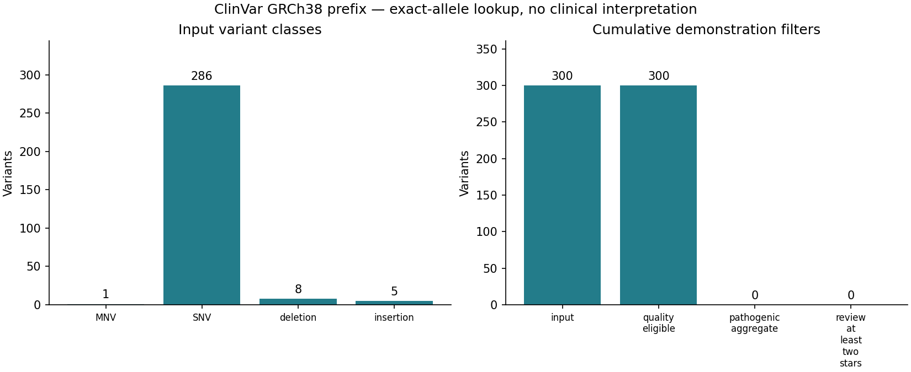

# Annotation report

Exact GRCh38 allele lookup against the bundled ClinVar snapshot.

Input: 300 records; unique keys: 300; matched: 300; unmatched: 0.

| Cumulative stage | Variants |
| --- | ---: |
| input | 300 |
| quality_eligible | 300 |
| pathogenic_aggregate | 0 |
| review_at_least_two_stars | 0 |

Missing gene: 0; missing consequence: 3.

FILTER '.' is unfiltered and is admitted by this demonstration rule.
Unknown review status receives zero stars. Clinical interpretation is not done.
The input was stripped from this same source: match coverage is a round-trip check, not accuracy.
